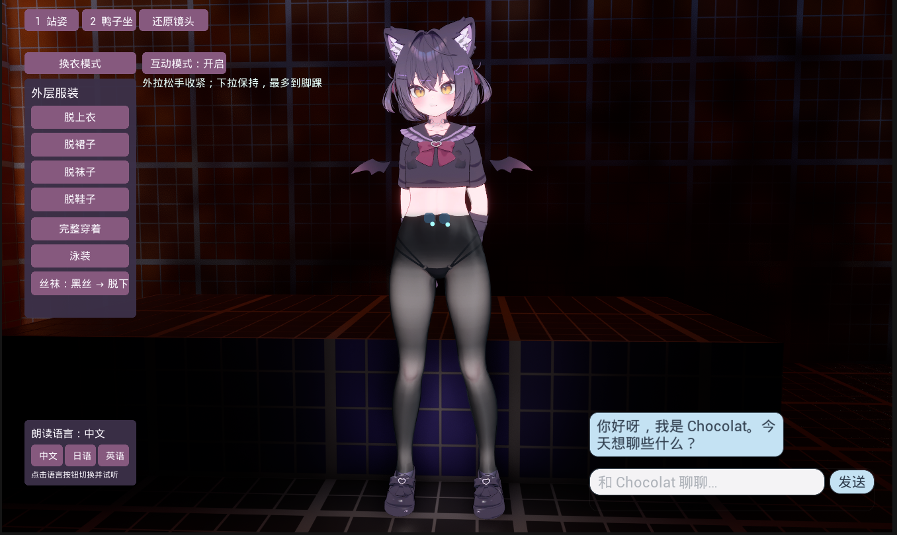
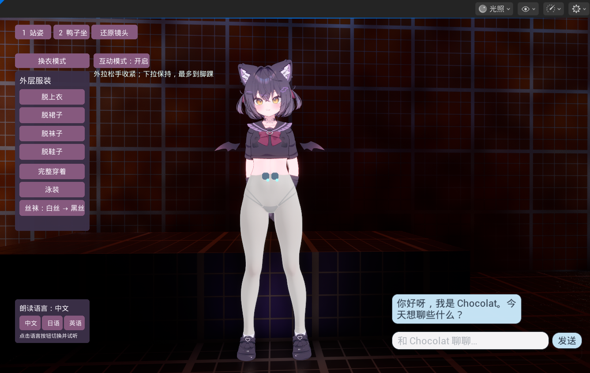
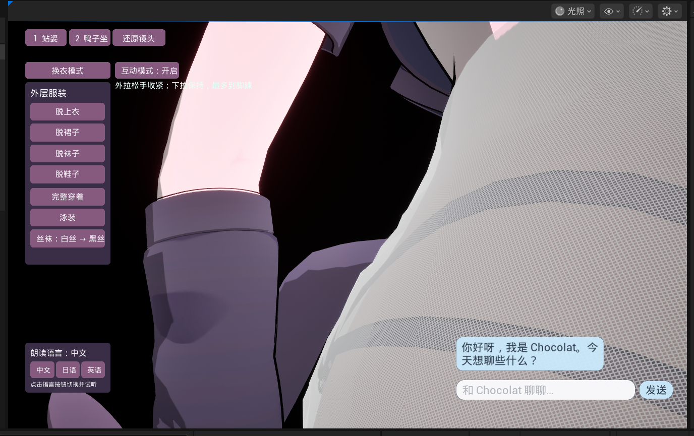
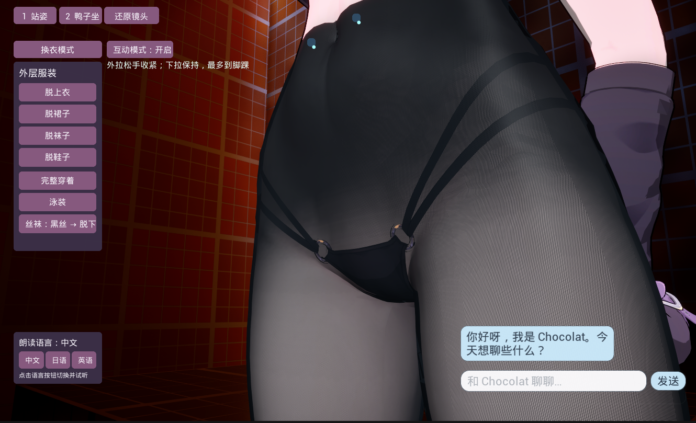
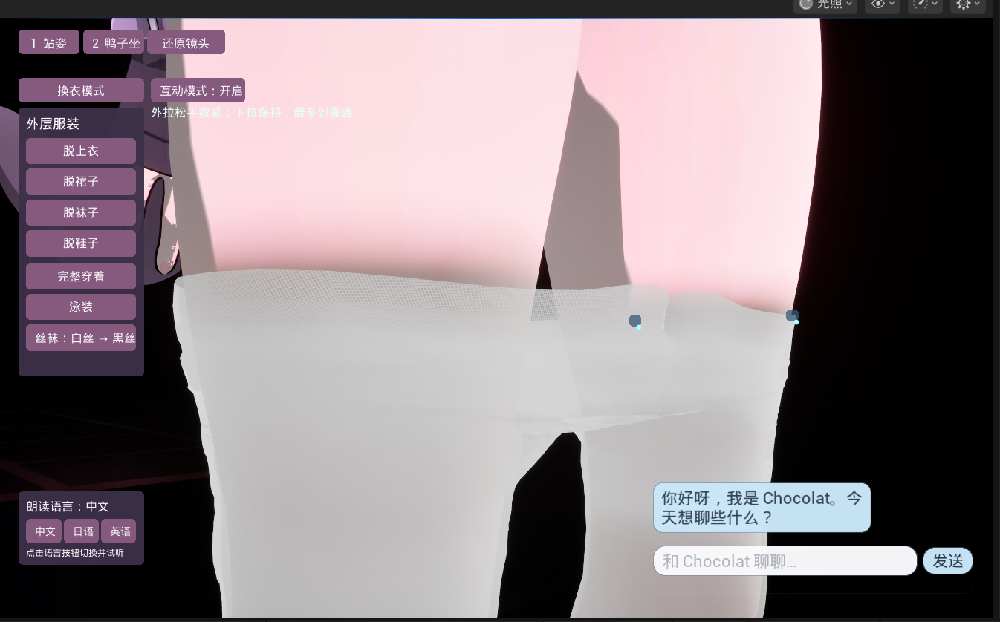
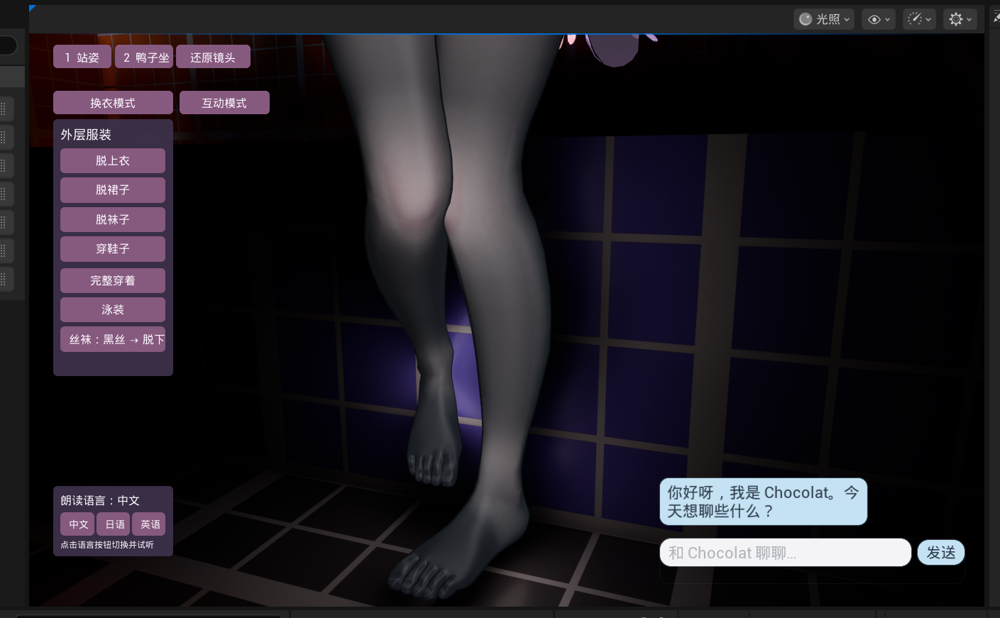

# UE 5.7 Interactive Stockings · 可互动连裤袜

UE 5.7 C++ 实现的连裤袜穿着与下拉交互，配套黑色/白色细纱网材质、身体与内层服装避让，以及近距离观察镜头。

左键抓住袜口外拉，松手快速收紧；向下拖动后保持当前位置，最多收拢到脚踝。普通穿着状态继续跟随原角色动画，互动状态临时安装站立贴合姿势，退出后恢复。

这是**沿身体轮廓引导的整件服装变形**。最终交互使用程序网格、截面映射和局部接触修正，不依赖 Chaos Cloth。当前范围到脚踝，尚未实现跨过脚掌并完全脱离身体。





## 功能

| 功能 | 实现 |
|---|---|
| 袜口抓取 | 世界射线选择袜口，投影到相机平面；沿焊接拓扑计算局部权重 |
| 外拉回弹 | 局部拉伸位移指数衰减，默认回弹率 22/s |
| 下拉保持 | 识别主导向下拖动，移动收拢前沿，松手保留高度 |
| 贴身与防穿模 | 身体三角面 BVH、内层泳裤/侧带/扣环接触、三角面交叉修正 |
| 纱网与透肤 | 经纬纤维、交错编织、孔隙、像素导数过滤、柔和纤维高光 |
| 压缩变厚 | 参考面积/当前面积生成纤维密度，UV 接缝共享密度和位置 |
| 普通/互动外观 | 共用组件灯光基准与黑白预设，程序顶点色保持线性 |
| 鞋内遮罩 | 穿鞋遮住低趾尖的袜面/皮肤，脱鞋恢复 |
| 观察镜头 | 中键旋转、右键平移、滚轮缩放；最近距离 20 cm |

## 目录

```text
Plugins/StockingsInteraction/  最终运行时 C++ 插件与最小宿主 Widget
Materials/                    最终 HLSL、黑白参数和皮肤/鞋内遮罩函数
Tools/build_materials.py       在 UE 编辑器中生成四组纱网材质/实例
Tools/validate_mesh.py         导出的网格交叉与接缝检查
docs/                         制作流程、接入步骤、材质说明、截图与验证说明
```

## 开始使用

1. 准备 UE 5.7、Windows C++ 编译工具链，以及有使用权的身体/连裤袜 Skeletal Mesh。
2. 将 `Plugins/StockingsInteraction` 复制到自己工程的 `Plugins`，启用插件并编译。
3. 身体与袜子使用同一骨骼、相同组件变换，袜子使用身体作为 Leader Pose。为需要打包运行的网格启用 CPU Access，并检查 LOD 数据可读取。
4. 在 UE 中运行材质生成脚本。脚本不下载模型或贴图，会在 `/Game/InteractiveStockings` 生成黑白普通/互动四组材质。
5. 按[材质接入](docs/materials.md)把透肤函数接入自己的身体材质，创建黑白皮肤实例。
6. 按[完整接入步骤](docs/integration.md)创建宿主 Widget、设置组件/镜头，并放置 Interaction Actor。仓库含可直接继承的最小 `UStockingsViewerWidget`，无需原项目聊天蓝图。
7. 将 Actor 六个材质属性指向生成的黑白袜材质与自己的黑白皮肤材质；确认身体/服装材质槽和参考空间避让范围。
8. PIE 中左键拖动青色袜口点。中键观察、右键平移、滚轮放大，退出互动恢复原动画。

在 UE Python 控制台中运行，路径替换为你的本地仓库路径：

```python
STOCKINGS_REPO_ROOT = r"C:/Projects/ue57-interactive-stockings"
script = STOCKINGS_REPO_ROOT + "/Tools/build_materials.py"
exec(compile(open(script, encoding="utf-8").read(), script, "exec"))
```

详见[最终制作流程](docs/workflow.md)、[算法结构](docs/architecture.md)、[接入教程](docs/integration.md)、[材质教程](docs/materials.md)及[全部九张截图](docs/gallery.md)。

## 效果细节

| 白色细纱网 | 黑色细纱网 |
|---|---|
|  |  |

| 白丝下拉 | 黑丝普通穿着 |
|---|---|
|  |  |

## 适用范围与验证

最终展示工程已检查白丝正面、两侧、背面、下拉约 10/20 cm、收拢到脚踝，以及黑丝侧面；八个采样状态的袜面与完整内层泳装 1204 面交叉为 0，UV 接缝位置误差为 0。身体检查中脚踝以上交叉为 0。这是所用角色和采样状态的验证结果，不代表所有模型、姿势或任意拖动都无穿模。

清理后的公开插件在独立 UE 5.7 工程中编译验证。材质生成脚本也在独立工程执行检查；替换原角色专属贴图后需要按自己的 UV、比例、光照和皮肤材质调整。详细范围见[验证说明](docs/validation.md)。

## 许可

原创代码和教程采用 [MIT](LICENSE)。本仓库不打包角色模型、贴图、动画或完整地图；截图中第三方角色资源的权利不随 MIT 许可转移，详见 [NOTICE](NOTICE.md)。
