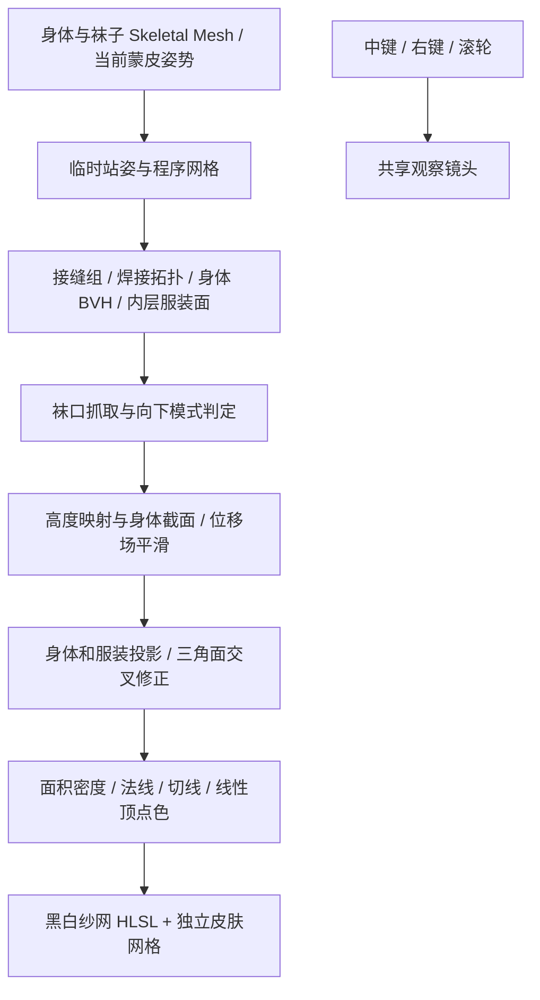

# 代码与算法

| 文件 | 责任 |
|---|---|
| `StockingsInteractionActor.cpp` | UI 生命周期、材质、输入、模式切换、原状态恢复 |
| `StockingsGeometry.cpp` | LOD0 读取、一次细分、UV 接缝组、法线与切线重算 |
| `StockingsTopology.cpp` | 原拓扑、身体面 BVH、最近点、袜口拓扑权重 |
| `StockingsAcceptedInteraction.cpp` | 外拉回弹、下拉保持、收拢高度、接触修正、密度编码 |
| `StockingsVisualAtlas.cpp` | 左右腿/躯干截面、轮廓映射、折叠与有限脚踝带 |
| `StockingsSwimContact.cpp` | 内层服装和小配件的局部层间避让 |
| `StockingsStandingPose.cpp` | 临时 Post Process Anim Instance；退出时恢复 |
| `StockingsViewerCameraLibrary.cpp` | 旋转、平移、角度与半径插值、输入互斥 |
| `StockingsViewerWidget.cpp` | 独立项目可用的最小宿主，或现有 UMG 的字段参考 |

## 响应与高度

外拉位移的更新为 `peel = lerp(peel, target, 1-exp(-rate*dt))`。默认 `rate=22/s`，目标偏移乘 .6 且最大 5 cm。

下拉高度以常速跟进目标；收拢前沿为 `TopZ-drop+6*progress^3`，带宽由 10 cm 过渡到 6 cm。分段积分的平滑 ramp 使高度映射连续且单调，防止袜面高度次序反转。

## 密度与接缝

`density = clamp(referenceArea/currentArea, .62, 2.4)`，顶点 R 为 `density/2.4`。同一参考位置的多个 UV 顶点共用同组位置和密度。渲染 buffer 是 UNorm8，验证时允许最多 `2.4/255` 的量化差异。

## 碰撞范围

身体读取指定材质槽；内层泳装读取指定材质槽及参考范围。点投影处理距离，分离轴检测处理渲染三角面的实际交叉。相机输入和网格形变都不会更改身体/泳装本体顶点。

参考骨骼、腿部轮廓构建、UV 覆盖、鞋尖坐标和材料槽仍需按新角色调整。现有实现适合站姿和当前比例，不保证坐姿互动、动态奔跑或任意形状服装。
