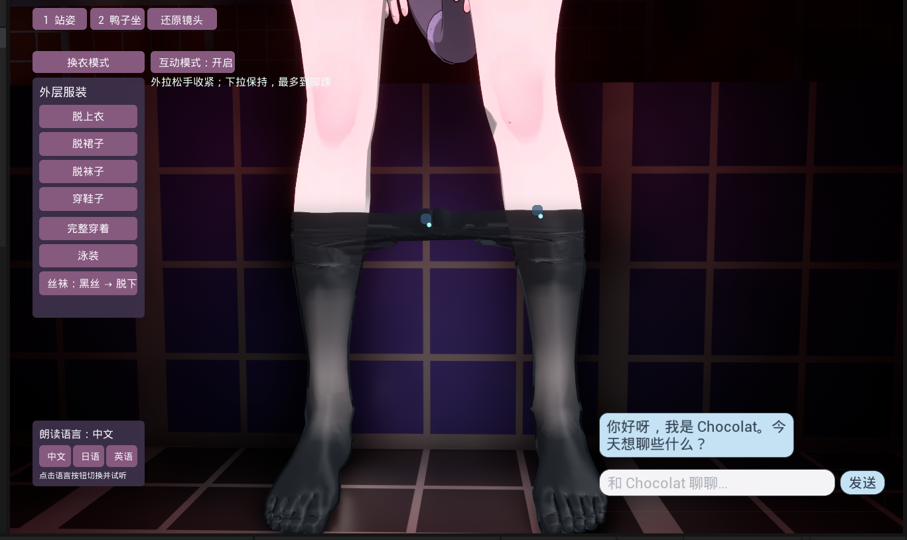
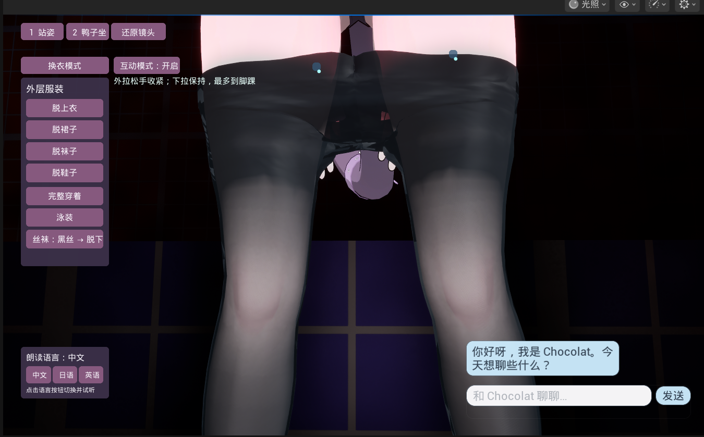

# 最终效果截图

八张图片由项目作者提供，原图保留，编号对应上传顺序。

## 1. 白丝整体与互动入口

## 2. 白色纱网近景

经纬孔隙、肤色和底层服装同时可见。

## 3. 白丝向下收拢

## 4. 黑色纱网与内层服装

## 5. 黑丝大腿收拢状态

## 6. 黑丝小腿收拢状态

## 7. 普通穿着的黑丝

原 Skeletal Mesh 继续跟随角色动画；此状态不运行下拉程序变形。

## 8. 黑丝收拢正面补充视角

图片展示效果与操作过程；当前完整交互限制到脚踝，未实现离开脚掌后完全脱下。
